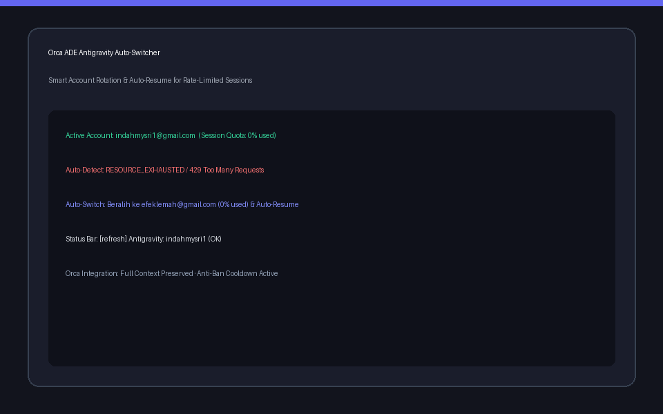
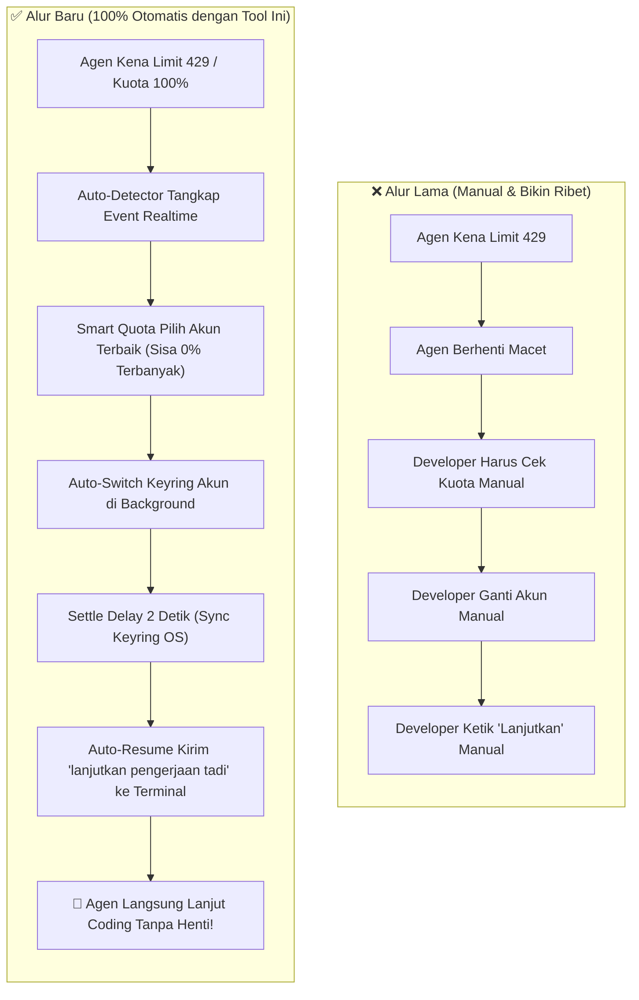

<p align="center">
  
</p>

<p align="center">
  <strong>Solusi otomatisasi rotasi akun Antigravity (<code>agy</code>) di Orca ADE. Gak perlu lagi ganti akun manual saat kuota habis atau kena limit 429.</strong>
</p>

<p align="center">
  
  
  
  
  
  
</p>

---

## 🎯 Masalah Utama: Kenapa Tool Ini Dibuat?

Di **Orca ADE**, agent **Antigravity (`agy`)** sangat powerful untuk coding otonom. Banyak developer yang menghubungkan beberapa akun sekaligus untuk cadangan kuota.

Tapi ada satu masalah besar: **Bawaan Orca saat ini BELUM BISA auto-switch akun Antigravity secara otomatis.**

Setiap kali akun aktif terkena rate limit (`HTTP 429 Too Many Requests` atau `RESOURCE_EXHAUSTED`):
1. 🛑 **Agen langsung berhenti bekerja di tengah jalan.**
2. 🔍 **Harus cek manual satu-satu:** Buka terminal, ketik perintah list akun, cari tahu akun mana yang kuotanya masih ada atau sudah reset.
3. 🔄 **Harus ganti akun secara manual:** Jalankan perintah switch atau klik ganti akun di UI.
4. ⌨️ **Harus ngetik manual lagi:** Masuk ke terminal aktif lalu ngetik *"lanjutkan pengerjaan"* agar agent mau jalan lagi.

Akibatnya? Kita harus terus-menerus **"nge-babysit"** agen AI. Niatnya pengen autonomous agent bekerja mandiri ditinggal ngopi, kenyataannya malah bolak-balik ngecek terminal gara-gara limit kuota.

**Tool ini hadir untuk menambal kekurangan tersebut!** Mengubah proses ganti manual yang merepotkan menjadi **100% otomatis di latar belakang**.

---

## ⚡ Solusi & Cara Kerjanya



---

## 🚀 Fitur Unggulan

### 1. 🔄 Otomatis Ganti Akun (Auto-Switch) Saat Limit
- Memantau log Orca secara streaming (`main.trace.ndjson`, `daemon.log`, transcript brain) untuk menangkap error `RESOURCE_EXHAUSTED` dan `429`.
- Dilengkapi **Proactive Quota Polling**: Jika kuota session akun aktif sudah menyentuh 100%, sistem langsung melakukan rotasi otomatis sebelum agen crash.
- Memprioritaskan akun dengan kuota paling kosong (Session & Weekly 0%).

### 2. 🤖 Auto-Resume ke Terminal Aktif
- Tidak cuma ganti akun, tool ini mencari terminal Orca yang sedang aktif dan writable.
- Memberi jeda aman *settle delay* (2 detik) agar kredensial OS tersinkronisasi.
- Mengirim trigger otomatis:
  ```bash
  orca terminal send --terminal <terminal_id> --text "lanjutkan pengerjaan tadi" --enter
  ```
  Agen langsung melanjutkan tugasnya tanpa kehilangan konteks percakapan!

### 3. 🛡️ Anti-Ban & Safety Engine
- **Cooldown 30 Detik:** Menghindari looping ganti akun terlalu cepat.
- **Circuit Breaker:** Jika terjadi lebih dari 5 kali pergantian dalam 3 menit, rotasi ditahan otomatis dan desktop alarm berbunyi agar akun aman dari flag abuse Google/Orca.
- **Single-Instance Lock:** Mencegah konflik antar proses via `/tmp/orca-agy-rotator.lock`.

### 4. 🧩 Dua Mode Pemakaian Fleksibel
- **Linux Systemd User Service:** Berjalan senyap di background sistem operasi Linux setiap kali login.
- **Native Orca Plugin v2 (`local.antigravity-rotator`):** Tampil langsung di status bar dan panel sidebar kanan Orca ADE dengan visual modern, indikator aktif `● IN USE`, dan tombol *Rotate Best*.

### 5. 🔒 Mode Privacy Masking
- Mau share screen, streaming, atau bikin dokumentasi? Cukup nyalakan Privacy Mask (`./main.py live -m` atau klik toggle di UI).
- Seluruh email asli otomatis disamarkan menjadi dummy (`dev-lead@example.com`, `worker-alpha@example.com`, dll.).

---

## 🖥️ Live Terminal Monitor (TUI)

Jalankan monitor interaktif di terminal Anda:

```bash
./main.py live
```

Tampilan di terminal:
```text
===============================================================================================
 STATUS         | EMAIL [PRIVACY MASK: ON]           | SESSION    | WEEKLY     | RESET TERDEKAT
===============================================================================================
 ▶ ● IN USE      | dev-lead@example.com               | 0%         | 0%         | 23:09:59 (109m lagi)
  ╰─ Routing aktif ke: Terminal 1 · main.py (Traffic AI diarahkan ke akun ini)
   ○ READY       | worker-alpha@example.com           | 27%        | 9%         | 23:25:32 (124m lagi)
   ○ READY       | runner-beta@example.com            | 1%         | 1%         | 23:43:11 (142m lagi)
   ○ READY       | agent-gamma@example.com            | 1%         | 1%         | 23:50:54 (150m lagi)
   ○ READY       | backup-ops@example.com             | 1%         | 1%         | 23:52:13 (151m lagi)
   ○ READY       | standby-pool@example.com           | 0%         | 0%         | 01:47:25 (266m lagi)
===============================================================================================
[Hotkeys] (r) Rotate Best  |  (m) Toggle Mask  |  (1-6) Direct Switch  |  (q) Exit
```

---

## 📂 Struktur Project

```text
agy auto switch/
├── config.json                 # Konfigurasi interval & safety
├── main.py                     # Entrypoint CLI & Live Monitor
├── orca-plugin.json            # Manifest resmi Plugin Orca ADE v2
├── rotator/                    # Engine inti Python
│   ├── account_manager.py      # Ranking kuota & integrasi Orca CLI
│   ├── config.py               # Config dataclass
│   ├── live_view.py            # TUI real-time monitor
│   ├── monitor.py              # Log streaming regex watcher
│   ├── notifier.py             # Linux desktop notification (notify-send)
│   ├── safety.py               # Cooldown, circuit breaker, lockfile
│   ├── service.py              # Orkestrator background daemon
│   └── terminal_manager.py     # Deteksi PTY & auto-resume injector
├── src/
│   └── worker.mjs              # Background trusted-worker untuk Orca Plugin
├── panel/
│   └── index.html              # UI Panel sidebar kanan Orca
├── images/
│   ├── icon.png                # Icon plugin resmi (128x128)
│   ├── icon.svg                # Master icon vector
│   └── cover.png               # Banner cover repositori
├── orca-agy-rotator.service    # Template systemd service Linux
├── install_service.sh          # Script otomatis instalasi service
└── test_rotator.py             # 7 unit test pengujian edge case
```

---

## 🚀 Panduan Instalasi

### Syarat Sistem:
- OS Linux (x86_64 atau aarch64)
- Python 3.10+ (Tanpa modul pip eksternal, hanya modul standar Python)
- Orca ADE terpasang dan sudah login akun Antigravity (`orca account login --agent antigravity`)

---

### Cara 1: Pasang Sebagai Plugin Resmi Orca ADE (Rekomendasi)

1. **Clone repository:**
   ```bash
   git clone https://github.com/syharipf/orca-antigravity-rotator.git
   cd orca-antigravity-rotator
   ```

2. **Validasi & Muat ke Orca (Development Mode):**
   ```bash
   # Validasi manifest v2
   orca plugin validate .

   # Muat plugin langsung ke runtime Orca
   orca plugin dev load .
   ```

3. **Buka Panel Switcher:**
   Klik icon **Antigravity Switcher** di sidebar kanan Orca atau jalankan:
   ```bash
   orca plugin open local.antigravity-rotator
   ```

---

### Cara 2: Pasang Sebagai Linux Systemd Service (Otomatis Aktif Saat Boot)

Service ini akan berjalan di latar belakang setiap kali Anda login ke OS Linux:

```bash
# 1. Pasang & aktifkan service otomatis
./main.py install-service

# 2. Cek status service
systemctl --user status orca-agy-rotator.service

# 3. Pantau log real-time
journalctl --user -u orca-agy-rotator.service -f
```

Untuk menghentikan atau mencopot service:
```bash
./main.py uninstall-service
```

---

## 🛠️ Panduan Perintah CLI

| Perintah | Deskripsi |
|---|---|
| `./main.py status` | Menampilkan status daemon, akun aktif, sisa kuota, dan terminal Orca |
| `./main.py accounts` | Menampilkan tabel seluruh akun beserta waktu countdown reset |
| `./main.py accounts --mask` | Menampilkan tabel akun dengan nama disamarkan (Privacy Mode) |
| `./main.py live` | Membuka TUI live monitor dengan hotkey pergantian cepat |
| `./main.py switch` | Memaksa rotasi ke akun dengan kuota paling kosong saat ini |
| `./main.py switch <email>` | Beralih ke akun email tertentu secara manual |
| `./main.py switch --dry-run` | Simulasi pemilihan akun tanpa benar-benar mengganti keyring |
| `./main.py resume --dry-run` | Menguji deteksi terminal aktif dan teks auto-resume |
| `./main.py test-notify` | Menguji notifikasi desktop Linux |
| `./main.py run` | Menjalankan daemon di foreground untuk debugging |

---

## ⚙️ Kustomisasi (`config.json`)

```json
{
  "log_check_interval": 1.0,
  "quota_check_interval": 20.0,
  "cooldown_seconds": 30.0,
  "circuit_breaker_max_switches": 5,
  "circuit_breaker_window_seconds": 180.0,
  "rotation_strategy": "smart_quota",
  "auto_resume": true,
  "resume_delay_seconds": 2.0,
  "resume_command": "lanjutkan pengerjaan tadi",
  "target_terminal": null,
  "notifications_enabled": true,
  "notification_app_name": "Orca ADE Rotator"
}
```

---

## 🧪 Pengujian Unit Test

Tool ini telah melalui serangkaian unit test pengujian skenario edge-case:

```bash
python3 test_rotator.py
```

```text
Ran 7 tests in 0.004s

OK
```

**Skenario yang diuji:**
1. Pemilihan kandidat akun dengan kuota paling kosong (*Smart Quota*).
2. Penanganan kondisi seluruh akun habis (*All Exhausted*) & hitung mundur waktu reset terdekat.
3. Strategi rotasi bergiliran (*Round-Robin*).
4. Penegakan waktu jeda cooldown (30 detik).
5. Pengaktifan circuit breaker jika terdeteksi pergantian berulang dalam waktu singkat.
6. Deteksi ekspresi reguler (regex) rate limit pada log streaming.
7. Penentuan prioritas terminal yang sedang aktif dan writable.

---

## 🔒 Keamanan & Privasi

- **Tidak Menyimpan Password/Token:** Tool ini sama sekali tidak menyimpan kredensial mentah. Semua proses pergantian akun menggunakan API resmi bawaan `orca account switch` yang terintegrasi dengan keyring sistem operasi.
- **Privacy Masking:** Tersedia opsi penyembunyian identitas akun agar aman digunakan saat *live coding*, presentasi, atau pembuatan konten.

---

## 📄 Lisensi

Didistribusikan di bawah lisensi **MIT License**. Silakan gunakan, modifikasi, dan kembangkan sesuai kebutuhan.
