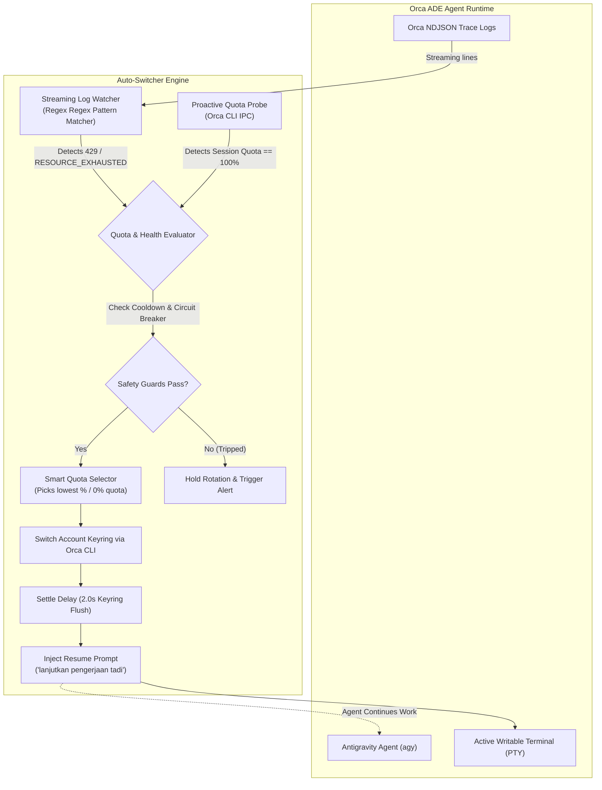

<p align="center">
  
</p>

<p align="center">
  <strong>Autonomous zero-downtime failover and quota rotator for Antigravity (<code>agy</code>) agents in Orca ADE.</strong>
</p>

<p align="center">
  
  
  
  
  
  
</p>

---

## ⚡ Overview

When running long, complex, or autonomous multi-agent coding sessions in **Orca ADE**, hitting API rate limits (`HTTP 429 Too Many Requests` or `RESOURCE_EXHAUSTED`) on **Antigravity (`agy`)** halts execution and discards active agent momentum.

**Orca ADE Antigravity Auto-Switcher** solves this bottleneck with an event-driven, dual-layer failover system:
1. **Linux User Daemon (`systemd --user`):** Continuously monitors Orca trace logs (`main.trace.ndjson`) and performs proactive quota polling via Orca IPC.
2. **Native Orca Plugin v2 (`local.antigravity-rotator`):** Runs a background `trusted-worker` and provides a high-density, real-time sidebar panel built with native Orca dark variables (`var(--orca-*)`) and zero AI slop.

When a rate limit is detected, the engine instantly selects the best available account (0% session quota), swaps the active keyring credentials, waits through a 2-second settle window, and automatically transmits a resume trigger (`"lanjutkan pengerjaan tadi"`) to the active writable terminal without breaking conversation context.

---

## 🌟 Key Architecture & Capabilities



### 1. Dual-Engine Real-Time Detection
- **Streaming Log Parser:** Reactively monitors `~/.config/orca/logs/main.trace.ndjson`, `daemon.log`, and ACP brain transcript files (`transcript*.jsonl`) using line-buffered regex search for `RESOURCE_EXHAUSTED`, `429 Too Many Requests`, and quota exhaustion patterns.
- **Proactive Quota Polling:** Periodically samples `orca account list --agent antigravity --json`. If the active account reaches `100%` session quota, rotation triggers preventatively before an agent turn crashes.

### 2. Smart Quota Ranking & Model Bucket Parity
- **Exact Orca Scale Parity:** Complies with Orca ADE's integer scale (`usedPercent: 0-100`). Accounts at `1%` or `2%` are kept active; only accounts with `usedPercent >= 100` are treated as exhausted.
- **Dynamic Model Buckets:** Transparently tracks and displays multi-tier model allocations (Gemini 2.5 Flash/Pro, Claude 3.7 Sonnet, GPT-4o, Argon, and Carbon).
- **Fallback Calculation:** If all accounts are exhausted, computes the shortest reset window (`reset_in_seconds`) and waits safely rather than hammering the API.

### 3. Automated Terminal Session Rehydration
- Identifies the currently active, connected, and writable Orca PTY terminal session.
- Implements a configurable **2.0s settle delay** ensuring new Google/Antigravity credentials flush into the OS keyring.
- Dispatches an automated continuation command (`orca terminal send --terminal <id> --text "lanjutkan pengerjaan tadi" --enter`) so the model seamlessly picks up the thread.

### 4. Circuit Breaker & Anti-Ban Protection
- **30s Cooldown Period:** Prevents rapid-fire switching loops.
- **Sliding-Window Circuit Breaker:** If more than 5 rotations happen within 180 seconds, halts switching and raises a high-priority desktop alert.
- **PID File Lock:** Enforces a single running instance via `/tmp/orca-agy-rotator.lock`.
- **Desktop Notifications:** Dispatches native Linux notifications via `notify-send`.

### 5. Privacy-First Engineering (Privacy Mask)
- Built-in `--mask` / `-m` flag on CLI and Privacy Mask toggle on the Orca UI.
- Masks real corporate and personal email addresses into sanitized aliases (`dev-lead@example.com`, `worker-alpha@example.com`, `standby-pool@example.com`) for secure screen sharing, live streaming, and open-source documentation.

---

## 🖥️ Live Terminal Interface (TUI)

Monitor routing and account quotas in real time via the built-in TUI:

```bash
./main.py live
```

```text
===============================================================================================
 STATUS         | EMAIL [PRIVACY MASK: ON]           | SESSION    | WEEKLY     | RESET TERDEKAT
===============================================================================================
 ▶ ● IN USE      | dev-lead@example.com               | 0%         | 0%         | 23:09:59 (109m lagi)
  ╰─ Routing aktif ke: Terminal 1 · main.py (Traffic AI diarahkan ke akun ini)
   ○ READY       | worker-alpha@example.com           | 27%        | 9%         | 23:25:32 (124m lagi)
   ○ READY       | runner-beta@example.com            | 1%         | 1%         | 23:43:11 (142m lagi)
   ○ READY       | agent-gamma@example.com            | 1%         | 1%         | 23:50:54 (150m lagi)
   ○ READY       | backup-ops@example.com             | 1%         | 1%         | 23:52:13 (151m lagi)
   ○ READY       | standby-pool@example.com           | 0%         | 0%         | 01:47:25 (266m lagi)
===============================================================================================
[Hotkeys] (r) Rotate Best  |  (m) Toggle Mask  |  (1-6) Direct Switch  |  (q) Exit
```

---

## 📦 Project Structure

```text
agy auto switch/
├── config.json                 # User-configurable thresholds & timeouts
├── main.py                     # Unified CLI & TUI entrypoint
├── orca-plugin.json            # Official Orca ADE Plugin v2 Manifest
├── rotator/                    # Core Python library
│   ├── account_manager.py      # Orca CLI IPC & smart quota ranker
│   ├── config.py               # Dataclass configuration loader
│   ├── live_view.py            # High-contrast interactive TUI monitor
│   ├── monitor.py              # Non-blocking streaming log watcher
│   ├── notifier.py             # Desktop notification dispatcher
│   ├── safety.py               # Cooldown, circuit breaker, & lockfile
│   ├── service.py              # Main daemon engine orchestrator
│   └── terminal_manager.py     # Orca PTY detection & resume injector
├── src/
│   └── worker.mjs              # Orca Plugin v2 trusted background worker
├── panel/
│   └── index.html              # Responsive Orca sidebar panel (Zero AI Slop)
├── images/
│   ├── icon.png                # Plugin icon (128x128)
│   └── cover.png               # Hero banner (960x600)
├── orca-agy-rotator.service    # Systemd user service unit template
├── install_service.sh          # One-click systemd installer
└── test_rotator.py             # 7/7 passing unit test suite
```

---

## 🚀 Getting Started

### Prerequisites
- **Linux** (x86_64 or aarch64, kernel 5.x+)
- **Python 3.10+** (Standard library only; zero external pip dependencies required)
- **Orca ADE** (`orca >= 1.4.248`) installed and authenticated with your accounts (`orca account login --agent antigravity`)
- `libnotify-bin` (optional, for desktop popups: `sudo apt install libnotify-bin`)

---

### Method A: Install Native Orca ADE Plugin (Recommended)

1. **Clone the repository:**
   ```bash
   git clone https://github.com/syharipf/orca-antigravity-rotator.git
   cd orca-antigravity-rotator
   ```

2. **Load into Orca in Development Mode:**
   ```bash
   # Validate plugin manifest v2
   orca plugin validate .

   # Load plugin into Orca runtime
   orca plugin dev load .
   ```

3. **Open the Switcher Panel:**
   Click the **Antigravity Switcher** icon in Orca's right sidebar or run:
   ```bash
   orca plugin open local.antigravity-rotator
   ```

---

### Method B: Install Linux Systemd Background Daemon

Keep the rotator running as an independent background daemon across all Orca sessions:

```bash
# 1. Install & enable systemd user service
./main.py install-service

# 2. Verify service status
systemctl --user status orca-agy-rotator.service

# 3. Stream real-time service logs
journalctl --user -u orca-agy-rotator.service -f
```

To stop or uninstall:
```bash
./main.py uninstall-service
```

---

## 🛠️ CLI Command Reference

| Command | Description |
|---|---|
| `./main.py status` | Shows daemon health, active account quota, and active Orca PTY terminal |
| `./main.py accounts` | Lists all accounts ranked by quota with reset countdowns |
| `./main.py accounts --mask` | Lists accounts with Privacy Masking enabled |
| `./main.py live` | Launches interactive real-time TUI with hotkey switching |
| `./main.py switch` | Automatically switches to the account with the lowest quota usage |
| `./main.py switch <email>` | Manually switches to a specific account |
| `./main.py switch --dry-run` | Simulates rotation without altering system keyring |
| `./main.py resume --dry-run` | Tests active terminal detection and auto-resume formatting |
| `./main.py test-notify` | Fires a test desktop notification |
| `./main.py run` | Runs daemon in the foreground for debugging |

---

## ⚙️ Configuration (`config.json`)

Fine-tune timing, thresholds, and resume behavior:

```json
{
  "log_check_interval": 1.0,
  "quota_check_interval": 20.0,
  "cooldown_seconds": 30.0,
  "circuit_breaker_max_switches": 5,
  "circuit_breaker_window_seconds": 180.0,
  "rotation_strategy": "smart_quota",
  "auto_resume": true,
  "resume_delay_seconds": 2.0,
  "resume_command": "lanjutkan pengerjaan tadi",
  "target_terminal": null,
  "notifications_enabled": true,
  "notification_app_name": "Orca ADE Rotator"
}
```

---

## 🧪 Automated Testing

Run the self-contained unit test suite verifying failover edge cases:

```bash
python3 test_rotator.py
```

```text
Ran 7 tests in 0.004s

OK
```

**Covered Scenarios:**
- Lowest-quota candidate selection (`test_select_best_account_smart_quota`)
- All accounts exhausted fallback & countdown resolution (`test_select_best_all_exhausted`)
- Round-robin rotation fairness (`test_select_best_account_round_robin`)
- Cooldown safety gate enforcement (`test_cooldown_enforcement`)
- Circuit breaker trip prevention under rapid failures (`test_circuit_breaker_trip`)
- Real-time regex pattern matching over streaming logs (`test_detect_limit_patterns`)
- Terminal prioritization and active PTY scoring (`test_terminal_priority`)

---

## 🔒 Security & Privacy

- **No Credential Interception:** The tool does not store, forward, or inspect API tokens. All credential handshakes are executed through the official `orca account switch` IPC API backed by OS keyrings.
- **Privacy Mask Mode:** Built-in hashing masks email identities on demand, preventing accidental disclosure during screencasts and presentations.
- **Safe Sandboxing:** Only operates within standard user-space permissions; no `root` privileges required.

---

## 📄 License

Distributed under the **MIT License**. See `LICENSE` for details.
